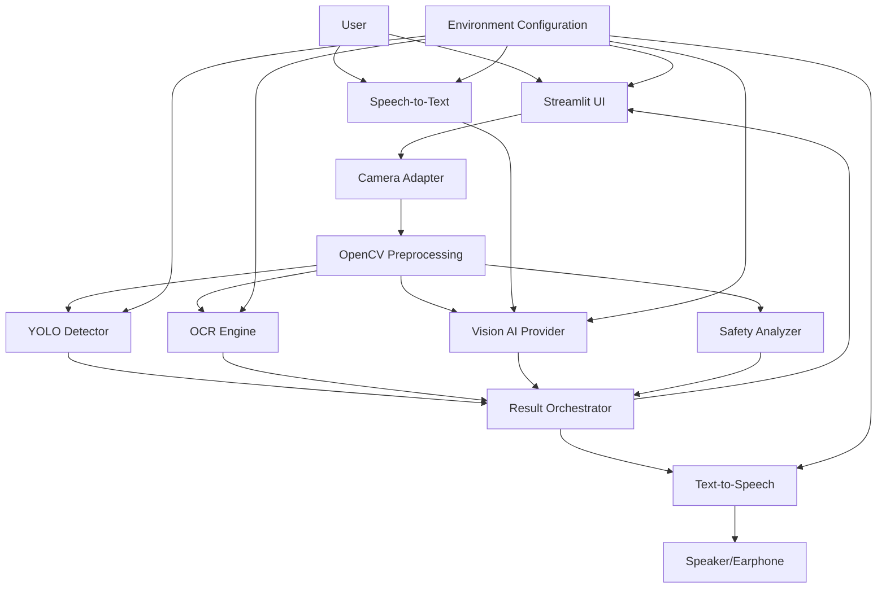

# architecture.md — VisionMate AI

## 1. System Overview

VisionMate AI is a modular Python application using Streamlit as the interactive frontend and OpenCV/AI services for visual and voice processing.

Primary pipeline:

```text
Laptop / Browser Camera
        ↓
Camera Adapter
        ↓
Frame Capture + Preprocessing
        ↓
 ┌──────┼───────────────┬──────────────┐
 ↓      ↓               ↓              ↓
YOLO   OCR          Vision AI       Safety Analyzer
 ↓      ↓               ↓              ↓
Objects Text       Scene/Answer     Warning
 └──────┴───────────────┴──────────────┘
                    ↓
             Result Orchestrator
                    ↓
             Text-to-Speech
                    ↓
             Speaker/Earphone
```

Future hardware:

```text
Smart Spectacles Camera
        ↓
USB / Wi-Fi / Bluetooth / Raspberry Pi / Phone
        ↓
Camera Adapter Interface
        ↓
Existing VisionMate Pipeline
```

## 2. Architecture Overview

The system should be divided into these layers:

1. Presentation
2. Application orchestration
3. Camera abstraction
4. Computer vision
5. OCR
6. Multimodal AI
7. Speech
8. Safety analysis
9. Configuration/security
10. Optional persistence

The core prototype does not require a database.

## 3. Architecture Diagram



## 4. Technology Stack

| Layer | Technology |
|---|---|
| Language | Python |
| UI | Streamlit |
| Image processing | OpenCV |
| Object detection | YOLO |
| OCR | Tesseract or EasyOCR |
| Scene understanding | Vision-capable AI model |
| Speech-to-text | Configurable STT provider |
| Text-to-speech | Configurable TTS provider |
| Camera | Browser/laptop camera initially |
| Future camera | USB/Wi-Fi/Bluetooth/Raspberry Pi/phone adapter |
| Configuration | Environment variables |
| Version control | Git/GitHub |
| Deployment | To Be Decided based on camera/hardware requirements |

The generic Next.js/Supabase stack is not used because the VisionMate project explicitly requests Python + Streamlit.

## 5. Frontend Architecture

Streamlit owns:
- Camera UI
- Feature controls
- Results
- Status
- Voice controls
- Configuration display where safe

The UI must not contain API secrets.

## 6. Backend/Application Architecture

Streamlit and Python modules act as the application backend for the prototype.

Recommended service modules:
- Camera service
- Detection service
- OCR service
- Vision AI service
- STT service
- TTS service
- Safety service
- Configuration service
- Result orchestration service

Each provider should be accessed through a stable interface so implementations can be replaced.

## 7. Camera Architecture

Define a camera interface conceptually:

```text
CameraSource
 ├── LaptopCameraSource
 ├── BrowserCameraSource
 ├── USBSpectaclesSource
 ├── NetworkCameraSource
 ├── RaspberryPiCameraSource
 └── PhoneStreamSource
```

The initial implementation only needs a laptop/browser camera source.

Future adapters must output a common frame representation.

## 8. YOLO Architecture

Flow:

```text
Frame → Resize/Normalize → YOLO Inference → Confidence Filtering
      → Bounding Boxes → Labels + Confidence → UI
```

Model selection is **To Be Decided** based on accuracy, hardware, speed, and licensing requirements.

The model must be loaded once where possible rather than repeatedly per interaction.

## 9. OCR Architecture

Supported conceptual providers:
- Tesseract
- EasyOCR

Flow:

```text
Image → Preprocessing → OCR → Text Cleanup → Display/TTS
```

Provider selection should be configurable.

## 10. Vision AI Architecture

Flow:

```text
Captured Image
     +
Optional User Question
     ↓
Image Encoding
     ↓
Vision-capable AI API
     ↓
Prompt/Instruction
     ↓
Concise Response
```

The AI provider is **To Be Decided**.

The implementation must:
- Use environment variables for credentials.
- Set timeouts.
- Handle API errors.
- Limit prompt/image size.
- Avoid unnecessary continuous uploads.

## 11. Speech-to-Text Architecture

```text
Microphone → STT Provider → Recognized Text → Vision AI
```

Provider is **To Be Decided**.

Microphone permission failures must not crash the application.

## 12. Text-to-Speech Architecture

```text
OCR / AI Response / Safety Warning
             ↓
             TTS
             ↓
        Audio Output
```

TTS provider is **To Be Decided**.

## 13. Safety Architecture

Safety Mode is a prototype warning mechanism, not a certified collision-avoidance system.

Possible logic:

```text
Frame
 ↓
Object Detection
 ↓
Relevant Object Filtering
 ↓
Visual/heuristic proximity estimation
 ↓
Warning threshold
 ↓
Warning cooldown
 ↓
Visual + Spoken Alert
```

Do not claim true distance unless a depth sensor/depth model is actually integrated and validated.

## 14. API Architecture

External APIs are provider-specific and should be wrapped behind internal service interfaces.

Potential integrations:
- Vision AI API
- STT API
- TTS API

No provider is mandated beyond the stated functionality.

## 15. API Endpoints

A standard Streamlit application does not require public REST endpoints for the initial prototype.

If API separation is later required, conceptual internal operations may include:

| Operation | Purpose |
|---|---|
| `POST /vision/describe` | Scene description |
| `POST /vision/ask` | Image + question |
| `POST /vision/detect` | Object detection |
| `POST /vision/ocr` | OCR |
| `POST /voice/transcribe` | STT |
| `POST /voice/speak` | TTS |

These are future architectural boundaries, not requirements to expose unauthenticated public endpoints.

## 16. Database Architecture

No database is required for core functionality.

Do not introduce PostgreSQL/Supabase merely to satisfy a generic technology template.

If persistence becomes necessary, possible records are:
- User settings
- Feedback
- Usage events
- Saved preferences

These are **To Be Decided**.

## 17. Authentication Architecture

No authentication is required for the initial local/demo application.

For future cloud multi-user deployment:
- Use an established authentication provider.
- Do not implement custom password storage unnecessarily.
- Use secure sessions.
- Define user roles only when actual requirements exist.

## 18. Authorization/RBAC

Not applicable to the initial single-user prototype.

Future admin roles are **To Be Decided**.

## 19. Data Flow

### Detection
Camera → OpenCV → YOLO → filtered detections → result state → UI.

### OCR
Camera → preprocessing → OCR → cleaned text → result state → UI/TTS.

### Scene
Camera → image encoding → vision AI → response → UI/TTS.

### Voice
Microphone → STT → question → image + question → vision AI → response → TTS.

### Safety
Camera → detection → warning logic → cooldown → UI/audio.

## 20. Form Submission Flow

Configuration inputs:

```text
User changes configuration
→ Validate value
→ Update application state/config
→ Reinitialize provider if necessary
→ Show actual readiness status
```

No secret value should be rendered back to the UI.

## 21. Admin Data Flow

No admin flow is required.

## 22. Image/File Upload Flow

The initial system uses camera frames rather than permanent file uploads.

If a file upload is added:

```text
Upload → Validate type/size → Decode → Preprocess
→ Process → Delete/discard unless explicit retention is required
```

## 23. Storage Architecture

Default:
- No persistent image storage.
- No persistent audio storage.

Temporary in-memory processing should be preferred.

If storage is later introduced, retention, access, encryption, and deletion rules must be defined first.

## 24. SEO Architecture

If publicly deployed:
- Streamlit page title
- Favicon
- Meta description where supported
- Open Graph via deployment/landing-page architecture where necessary
- `robots.txt` and sitemap for public indexable routes

SEO for the interactive application is secondary to application usability.

## 25. Security Architecture

Security principles:
- Secrets outside source code.
- Least privilege.
- HTTPS in production.
- Input validation.
- Provider timeouts.
- Safe error messages.
- No sensitive logs.
- No unnecessary data retention.
- Dependency updates.
- Access control if multi-user functionality is added.

## 26. Validation

Validate:
- Configuration values
- Confidence thresholds
- File/image size if uploads exist
- Image decoding
- Voice input availability
- Provider responses
- AI response length where appropriate

## 27. Error Handling

Errors must be classified:
- User/input
- Device
- Model
- Provider/API
- Network
- Configuration
- Internal

User output should be concise. Full stack traces should only be available in secure developer logs during development.

## 28. Logging

Log:
- Startup/provider readiness
- Model loading failures
- Non-sensitive operation failures
- Processing durations
- Application exceptions

Do not log:
- API keys
- Raw audio unnecessarily
- Raw camera images unnecessarily
- Sensitive user questions unnecessarily

## 29. Monitoring

For a local hackathon prototype:
- Streamlit runtime logs
- Provider errors
- Model load failures
- CPU/RAM/GPU utilization during performance testing

For future production deployment, external monitoring is **To Be Decided**.

## 30. Environment Variables

Example `.env` concept:

```text
VISION_AI_API_KEY=
VISION_AI_MODEL=
STT_API_KEY=
TTS_API_KEY=
YOLO_MODEL_PATH=
OCR_ENGINE=
YOLO_CONFIDENCE=
SAFETY_WARNING_INTERVAL=
```

Only required variables should be used. Secrets must never be committed to Git.

## 31. Project Folder Structure

Recommended:

```text
visionmate-ai/
├── app.py
├── requirements.txt
├── .env.example
├── .gitignore
├── README.md
├── config/
│   └── settings.py
├── camera/
│   ├── base.py
│   ├── laptop_camera.py
│   └── adapters/
│       ├── usb.py
│       ├── network.py
│       ├── raspberry_pi.py
│       └── phone.py
├── vision/
│   ├── detector.py
│   ├── ocr.py
│   ├── scene.py
│   └── safety.py
├── voice/
│   ├── stt.py
│   └── tts.py
├── services/
│   └── orchestrator.py
├── ui/
│   ├── header.py
│   ├── camera_panel.py
│   ├── results.py
│   ├── controls.py
│   └── status.py
├── utils/
│   ├── image.py
│   ├── validation.py
│   └── logging.py
└── tests/
    ├── test_camera.py
    ├── test_detection.py
    ├── test_ocr.py
    ├── test_safety.py
    └── test_validation.py
```

## 32. Component Structure

Core interfaces:
- Camera source
- Detector
- OCR engine
- Vision AI client
- STT client
- TTS client
- Safety analyzer

The UI should call orchestration services rather than embedding provider-specific code in widgets.

## 33. Route Structure

Streamlit does not require conventional REST routes for the initial application.

Conceptual views:
- Main
- Privacy
- Terms

## 34. Admin Route Structure

Not applicable.

## 35. Middleware

Streamlit does not use Next.js-style middleware.

Equivalent controls belong in:
- Configuration validation
- Service wrappers
- Input validation
- Authentication layer if added
- Request/provider timeout controls

## 36. Supabase Configuration

Supabase is not required for the current prototype.

If future persistence is introduced, it must be implemented only after:
- Schema is defined
- Tables are created
- Access policies are verified
- CRUD is tested
- Secrets are securely configured

No fake Supabase layer should be added.

## 37. Row Level Security

Not applicable without a database.

If Supabase is later added, RLS must be enabled for user-facing tables and tested against authorized/unauthorized access.

## 38. API Security

- HTTPS
- Secrets in environment variables
- Timeouts
- Rate limits where provider supports them
- Validate outbound inputs
- Restrict accepted content
- Do not expose provider credentials

## 39. Rate Limiting

Safety Mode and external AI calls must have practical throttling.

Implement:
- Frame processing interval
- AI request cooldown
- Voice request cooldown
- Safety speech cooldown

Provider-side rate limits must also be respected.

## 40. XSS Protection

Streamlit generally controls rendering, but avoid unsafe HTML rendering of AI/OCR/user text. If custom HTML is used, sanitize content first.

## 41. CSRF Protection

The application should rely on Streamlit's framework protections for normal UI interaction. If custom APIs are added, implement CSRF protection appropriate to their authentication model.

## 42. SQL Injection Protection

No SQL is required in the initial application.

If a database is later added, use parameterized queries/official SDK methods and never concatenate untrusted values into SQL.

## 43. CORS

No separate public API is required initially.

If APIs are introduced, restrict origins to known application domains and avoid wildcard CORS for authenticated endpoints.

## 44. Content Security Policy

For production deployment, configure CSP at the hosting/proxy layer where supported. Policy must permit only required scripts, styles, media, and API connections.

## 45. Secure Authentication

Not required for the local prototype.

If future authentication is added:
- Use established identity services.
- Secure cookies/tokens.
- Strong credential policy.
- Brute-force protection.
- Logout.
- Session expiration.

## 46. Session Management

Use Streamlit session state only for non-sensitive application state where appropriate.

Do not treat session state as secure long-term storage.

## 47. Password Reset

Not applicable because authentication is not required.

## 48. MFA

Not required for the current prototype.

For future admin/cloud accounts, MFA may be required based on risk.

## 49. Deployment Architecture

The application requires a Python-capable runtime.

Deployment choice is **To Be Decided** based on:
- Camera access
- GPU requirements
- Model size
- Microphone access
- External API use
- Hardware integration

A cloud deployment must not assume direct access to a user's physical laptop camera unless the chosen Streamlit/browser architecture supports it.

## 50. Vercel Deployment

Vercel is not the natural primary runtime for a Python Streamlit application. It should not be forced into the architecture.

If a separate Next.js landing page is later requested, Vercel can host that frontend while the Streamlit/AI service runs separately.

## 51. Git/GitHub Workflow

Branches:
- `main`
- `develop` if required
- feature branches

Workflow:

```text
Create branch
→ Implement small feature
→ Run tests
→ Run application
→ Verify UI
→ Fix errors
→ Re-test
→ Commit
→ Review
→ Merge
```

Never commit `.env`.

## 52. Backup/Recovery

For the initial stateless prototype:
- Git repository is the primary source backup.
- Model files should be reproducibly downloadable or stored according to licensing.
- Configuration should be represented by `.env.example`, not secret values.

If persistent data is later introduced, database backup/recovery must be added.

## 53. Scalability

Potential scaling paths:
- Separate inference service
- GPU inference
- Queue-based AI requests
- External vision AI
- Dedicated camera gateway
- WebSocket/streaming transport for smart spectacles
- Caching model instances

Do not prematurely implement these if they are unnecessary for the hackathon prototype.

## 54. Performance Optimization

- Cache YOLO model.
- Resize frames.
- Limit inference frequency.
- Use GPU where available.
- Avoid duplicate AI requests.
- Compress images before external transmission.
- Keep UI updates focused.
- Use TTS cooldowns.
- Measure latency before optimizing.

## 55. Testing Architecture

Testing layers:

1. Unit tests for image/config/validation logic.
2. Service tests for detection/OCR/AI/voice wrappers.
3. Integration tests for provider interactions where practical.
4. UI/manual tests for Streamlit workflows.
5. End-to-end demo tests.
6. Performance tests.
7. Security tests.

## 56. Continuous Development Requirement

Never use:

**BUILD EVERYTHING → TEST AT THE END**

Use:

**INSPECT → IMPLEMENT → RUN → TEST → IDENTIFY ERROR → FIX → RE-RUN → RE-TEST → VERIFY EXISTING FEATURES → CONTINUE**

Every major feature must pass its checkpoint before the next feature is started.

## 57. Real-Functionality Rule

The implementation must not use:
- Fake object detections
- Fake AI responses
- Fake OCR
- Fake voice output
- Hardcoded readiness states
- Fake safety alerts

Demo fallback data may be used only in explicitly labeled offline/test mode and must never masquerade as live functionality.

## 58. Smart-Spectacles Integration Contract

Future camera adapters should provide:
- Frame retrieval
- Resolution metadata
- Timestamp
- Connection status
- Disconnect handling

Possible transports:
- USB
- Wi-Fi
- Bluetooth where appropriate for metadata/control
- Raspberry Pi
- Phone relay

The rest of the application should not need to know which hardware generated the frame.

## 59. Data Privacy

By default:
- Do not persist frames.
- Do not persist audio.
- Do not store user questions unnecessarily.
- Send only required images to external AI.
- Document third-party provider processing.

## 60. Production Security Checklist

- [ ] Secrets externalized
- [ ] HTTPS
- [ ] No debug mode
- [ ] Safe errors
- [ ] Dependency audit
- [ ] Provider permissions minimized
- [ ] Rate limits
- [ ] Input validation
- [ ] No unsafe HTML
- [ ] No unnecessary image/audio retention
- [ ] Monitoring
- [ ] Backup strategy if persistence exists
